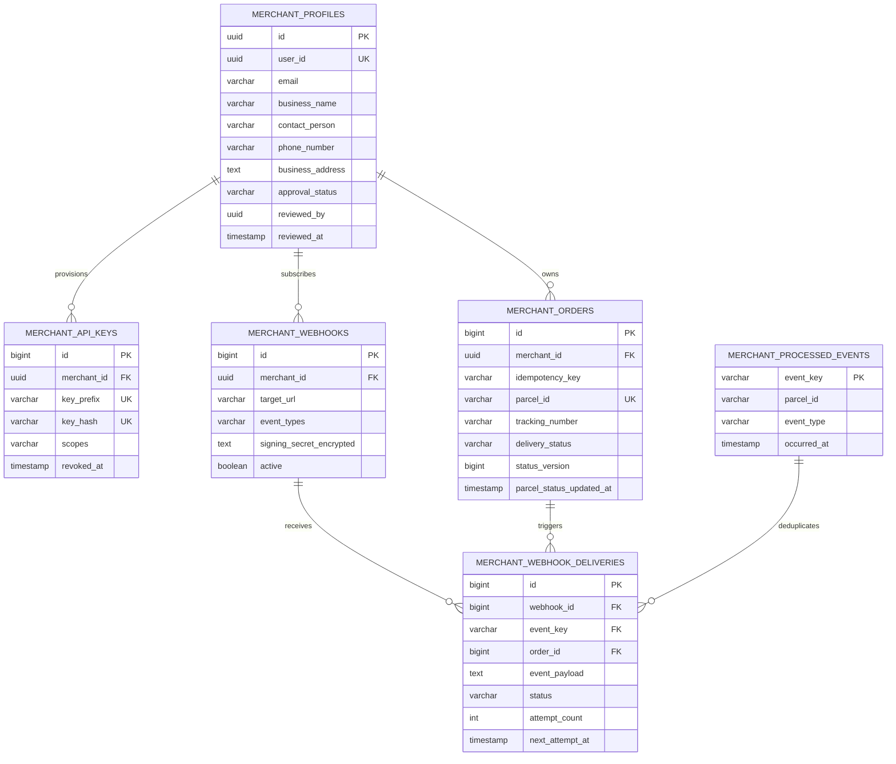
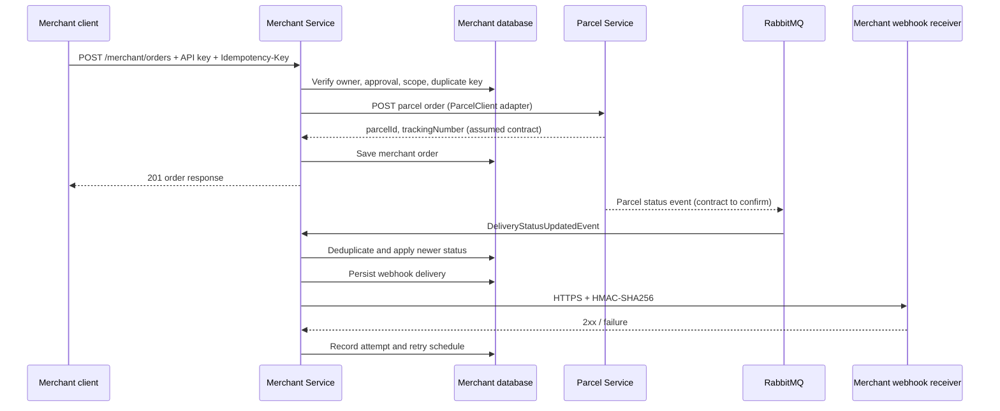

# SwiftDrop — Merchant Service API Contract (v1)

**Service**: Merchant Service (Member 4)  
**Direct URL**: `http://localhost:8083/api/v1/merchant`  
**Gateway URL**: `http://localhost:8080/api/v1/merchant` (requires the route change listed below)  
**Database**: `swiftdrop_merchant` (PostgreSQL)  
**OpenAPI UI**: `http://localhost:8083/swagger-ui.html`  
**Postman**: [`SwiftDrop_Merchant_Service.postman_collection.json`](../../services/merchant-service/SwiftDrop_Merchant_Service.postman_collection.json)

## 1. Overview

The Merchant Service owns a local merchant profile and approval state, scoped API keys, merchant order records, and signed webhook subscriptions. It stores no Identity or Parcel data outside the identifiers and order-status information needed for its own workflows.

All REST responses use the Dispatch response envelope:

```json
{
  "success": true,
  "message": "Order accepted",
  "data": {},
  "timestamp": "2026-11-12T12:00:00"
}
```

Error responses retain `success`, `message`, optional `data`, and `timestamp`. Validation errors return `400` with field names under `data`; authorization errors return `401` or `403`; unknown failures do not expose stack traces or internal details.

## 2. Authentication and approval

- Merchant registration requires a valid Identity Service Bearer JWT with `ROLE_MERCHANT`. The JWT subject is the Identity user UUID; `email` is used to initialize the local profile.
- Admin review requires `ROLE_ADMIN`.
- Orders, dashboard, API key issuance, and webhook management require a locally `APPROVED` Merchant profile.
- API keys are sent in `X-API-Key`. They authenticate as the owning merchant and are limited to the issued scope set. API keys cannot manage profiles, keys, or webhooks.
- Identity issues the exact authorities `ROLE_CUSTOMER`, `ROLE_MERCHANT`, `ROLE_COURIER`, and `ROLE_ADMIN`. The Merchant Service validates the JWT signature with the configured shared `JWT_SECRET`.

Identity Service currently has its own merchant approval workflow. This service owns its local approval state but does not update Identity's records or read its database. Until Member 2 agrees to a handoff, administrators may need to approve the merchant in each service for both Identity login policy and Merchant APIs to reflect approval.

## 3. Merchant profile and administration

| Method | Endpoint | Access | Description |
|---|---|---|---|
| `POST` | `/api/v1/merchant/profile` | `ROLE_MERCHANT` | Register a local profile in `PENDING` state |
| `GET` | `/api/v1/merchant/profile` | `ROLE_MERCHANT` | Retrieve own profile and approval state |
| `PUT` | `/api/v1/merchant/profile` | `ROLE_MERCHANT` | Update own business profile |
| `GET` | `/api/v1/merchant/admin/registrations/pending` | `ROLE_ADMIN` | List pending registrations |
| `PATCH` | `/api/v1/merchant/admin/registrations/{merchantId}/approve` | `ROLE_ADMIN` | Approve a pending profile |
| `PATCH` | `/api/v1/merchant/admin/registrations/{merchantId}/reject` | `ROLE_ADMIN` | Reject a pending profile |

`POST /profile` example:

```json
{
  "businessName": "Northwind Goods",
  "contactPerson": "Demo Merchant",
  "phoneNumber": "+94770000000",
  "businessAddress": "1 Market Road"
}
```

The service associates the profile with the subject UUID and email claim in the authenticated Identity JWT; the request cannot choose another user's ID. Reviews accept an optional `{"notes":"Verified business registration"}` payload. Rejected or approved profiles cannot be reviewed again.

## 4. Scoped API keys

| Method | Endpoint | Access | Description |
|---|---|---|---|
| `POST` | `/api/v1/merchant/api-keys` | `ROLE_MERCHANT`, approved, JWT only | Issue a scoped key; complete key shown once |
| `GET` | `/api/v1/merchant/api-keys` | `ROLE_MERCHANT`, approved, JWT only | List prefixes, scopes, and revocation state |
| `DELETE` | `/api/v1/merchant/api-keys/{keyId}` | `ROLE_MERCHANT`, approved, JWT only | Revoke an owned key |

Allowed scopes are `orders:read`, `orders:write`, and `dashboard:read`. Example:

```json
{"scopes":["orders:read","orders:write"]}
```

The key is generated from a cryptographically secure random source. Only its SHA-256 hash and non-secret prefix are persisted. Store the returned `key` securely; it cannot be retrieved again. An API key without the necessary scope receives `403`.

## 5. Orders and dashboard

| Method | Endpoint | Access | Description |
|---|---|---|---|
| `POST` | `/api/v1/merchant/orders` | JWT merchant or API key with `orders:write` | Validate, call Parcel Service, and save a local order |
| `GET` | `/api/v1/merchant/orders` | JWT merchant or API key with `orders:read` | List only the caller's orders and latest delivery state |
| `GET` | `/api/v1/merchant/orders/dashboard/summary` | JWT merchant or API key with `dashboard:read` | Own order counts and webhook success/failure totals |

Order creation requires an `Idempotency-Key` header matching `[A-Za-z0-9._:-]{1,100}`. Repeating the same key and payload returns the existing local order; reusing that key for a different payload returns `409`.

```http
POST /api/v1/merchant/orders
Authorization: Bearer <Identity JWT>
Idempotency-Key: storefront-order-1042
Content-Type: application/json
```

```json
{
  "recipientName": "Sample Recipient",
  "recipientPhone": "+94771111111",
  "deliveryAddress": "4 Galle Road, Colombo",
  "pickupAddress": "Northwind Warehouse, Colombo",
  "description": "Books",
  "weightKg": 1.5
}
```

Successful creation returns `201 Created` with a local order record containing the Parcel ID and tracking number returned by Parcel Service. A Parcel failure returns `502 Bad Gateway` and does not create the local order.

### Parcel Service integration — assumption requiring Member 3 confirmation

Parcel Service currently has no API contract in the repository. The Merchant adapter is isolated behind `ParcelClient`; its base URL is configurable with `PARCEL_SERVICE_URL` and its path with `PARCEL_ORDER_PATH`. Until Member 3 publishes the contract, the adapter assumes:

- `POST ${PARCEL_SERVICE_URL}${PARCEL_ORDER_PATH}` with `Idempotency-Key` header.
- Request fields `merchantOrderReference`, `recipientName`, `recipientPhone`, `deliveryAddress`, `pickupAddress`, `description`, and `weightKg`.
- A JSON response with `parcelId` and optional `trackingNumber`.

The default path `/api/v1/parcels` is only a placeholder assumption, not a confirmed Parcel contract. Match it to Member 3's documented endpoint before production integration.

The summary returns `totalOrders`, `ordersByStatus`, `successfulWebhookDeliveries`, and `failedWebhookDeliveries`.

## 6. Webhook subscriptions and delivery

| Method | Endpoint | Access | Description |
|---|---|---|---|
| `POST` | `/api/v1/merchant/webhooks` | Approved merchant JWT | Create subscription; secret shown once |
| `GET` | `/api/v1/merchant/webhooks` | Approved merchant JWT | List own subscriptions without secret |
| `PUT` | `/api/v1/merchant/webhooks/{webhookId}` | Approved merchant JWT | Update subscription and rotate signing secret |
| `DELETE` | `/api/v1/merchant/webhooks/{webhookId}` | Approved merchant JWT | Disable subscription |
| `GET` | `/api/v1/merchant/webhooks/{webhookId}/deliveries` | Approved merchant JWT | View attempts for an owned webhook |
| `POST` | `/api/v1/merchant/webhooks/{webhookId}/deliveries/{deliveryId}/redeliver` | Approved merchant JWT | Immediately retry a failed delivery |

Only `parcel.status.changed` subscriptions are currently supported. Example:

```json
{
  "targetUrl": "https://merchant.example.com/swiftdrop-hook",
  "eventTypes": ["parcel.status.changed"]
}
```

The response includes `signingSecret` only on create or secret-rotating update. It is encrypted at rest using AES-GCM and `WEBHOOK_ENCRYPTION_KEY` (at least 32 characters). A receiver must calculate HMAC-SHA256 over the exact raw request body and compare it to `X-SwiftDrop-Signature: sha256=<lowercase-hex>`. `X-SwiftDrop-Event-Id` carries the stable event key.

By default, the service accepts only HTTPS targets, rejects URLs with credentials, query, fragments, non-standard ports, unresolved hosts, and any target resolving to a non-public IP. Redirects are not followed. For the controlled local demo only, set `WEBHOOK_ALLOW_LOCALHOST=true`; this permits local HTTP and arbitrary ports on loopback. Do not enable this on a deployed service.

Webhook delivery records persist payload, state, attempts, timestamps, HTTP status, and a sanitized failure description in `swiftdrop_merchant`. The scheduler replays due `PENDING` rows after restart, uses bounded exponential backoff, and marks a delivery `FAILED` after `WEBHOOK_MAX_ATTEMPTS` (default 5). Manual redelivery resets the attempt count and starts another delivery cycle.

The included demo receiver is `POST /api/v1/merchant/demo/webhook`. It acknowledges the receipt and whether the signature header is present. It is a demo endpoint, not a production HMAC verifier; production receiver code must verify the signature against the raw body.

## 7. RabbitMQ status events

The Merchant Service declares its own durable queue, bound to the existing durable topic exchange:

| Setting | Default |
|---|---|
| Exchange | `dispatch.exchange` |
| Queue | `swiftdrop.merchant.status-updated.queue` |
| Routing key | `dispatch.status.updated` |
| Converter | `Jackson2JsonMessageConverter` |
| Rejected-message route | Durable `swiftdrop.merchant.rejected.queue` via `swiftdrop.merchant.dlx` |

The listener consumes the Dispatch `DeliveryStatusUpdatedEvent` shape:

```json
{
  "eventType": "DELIVERY_STATUS_UPDATED",
  "assignmentId": 100,
  "parcelId": "parcel-100",
  "trackingNumber": "SWIFT-COL-100",
  "courierId": 1,
  "previousStatus": "IN_TRANSIT",
  "newStatus": "DELIVERED",
  "failureReason": null,
  "notes": null,
  "timestamp": "2026-11-12T12:00:00"
}
```

The publisher's current event has no `eventId` or `version`. The consumer uses Rabbit message ID when available; otherwise it hashes stable event fields for deduplication. Status updates use `version` if supplied, else the event timestamp, and ignore older states. This cannot reliably distinguish two otherwise-identical events when the publisher supplies neither ID nor version.

The Merchant README calls out Parcel events `parcel.status_updated`; the requested name `parcel.status.changed` and the implemented Dispatch name `dispatch.status.updated` are not currently the same contract. This service binds to the event actually emitted by the implemented Dispatch Service and translates its status into a `parcel.status.changed` merchant webhook. Member 3/5 should confirm exchange, routing key, event version/ID and payload before the system contract is frozen.

## 8. Error responses

Examples:

```json
{
  "success": false,
  "message": "Validation failed",
  "data": {
    "recipientName": "Recipient name is required"
  },
  "timestamp": "2026-11-12T12:00:00"
}
```

| HTTP status | Meaning |
|---:|---|
| `400` | Invalid JSON, missing fields, or request validation error |
| `401` | Missing, invalid, or revoked JWT/API key |
| `403` | Wrong role, insufficient API key scope, or merchant not approved |
| `404` | Merchant-owned profile, resource, or delivery not found |
| `409` | Duplicate profile, reused idempotency key with changed payload, invalid state transition, or unsafe webhook URL |
| `502` | Parcel Service request failed |
| `500` | Unexpected server/configuration failure; no stack trace or sensitive detail returned |

## 9. Database model



Flyway initialization: `services/merchant-service/src/main/resources/db/migration/V1__init_merchant_schema.sql`. The Identity user and reviewer UUIDs are references by value only; there are intentionally no cross-database foreign keys.

## 10. Design documentation notes

### Use case

An Identity-registered merchant creates a business profile. An administrator approves it. The merchant issues an API key scoped to order operations, submits a request with an idempotency key, and receives a Parcel-backed local order. Parcel status changes update the merchant-owned order and trigger HMAC-signed webhooks. Failures are retained and retried; a merchant can inspect logs and redeliver a failed event.

### Order sequence



### Patterns

- **Repository pattern** for persistence.
- **Adapter/port pattern** (`ParcelClient`) isolates the unconfirmed Parcel HTTP contract.
- **API response envelope** matches Dispatch.
- **Durable event-consumer/read-model pattern** updates Merchant's local order record from RabbitMQ.
- **Idempotency and inbox deduplication** protect order creation and event processing.
- **Persistent retry queue in the database** survives application restarts.
- **Least-privilege API keys** enforce operation scopes.

## 11. Handoff changes for shared files (not made)

### Member 10 — Gateway route

The service exposes the requested singular `/api/v1/merchant/**` API prefix. Replace the reserved Merchant predicate or add this route:

```yaml
- id: merchant-service
  uri: ${MERCHANT_SERVICE_URL:http://merchant-service:8083}
  predicates:
    - Path=/api/v1/merchant/**
```

The current gateway only routes `/api/v1/merchants/**` (plural); without this shared edit, direct service calls work but these contract paths will not route through the gateway.

### DevOps / Compose service block

Add a Merchant service entry to `docker-compose.yml` and add it to the gateway's `MERCHANT_SERVICE_URL` environment and `depends_on` list:

```yaml
merchant-service:
  build:
    context: ./services/merchant-service
    dockerfile: Dockerfile
  container_name: swiftdrop-merchant-service
  restart: unless-stopped
  ports:
    - "${MERCHANT_SERVICE_PORT:-8083}:8083"
  environment:
    SPRING_PROFILES_ACTIVE: docker
    SPRING_DATASOURCE_URL: jdbc:postgresql://postgres:5432/swiftdrop_merchant
    SPRING_DATASOURCE_USERNAME: ${POSTGRES_USER}
    SPRING_DATASOURCE_PASSWORD: ${POSTGRES_PASSWORD}
    JWT_SECRET: ${JWT_SECRET}
    WEBHOOK_ENCRYPTION_KEY: ${WEBHOOK_ENCRYPTION_KEY}
    PARCEL_SERVICE_URL: ${PARCEL_SERVICE_URL:-http://parcel-service:8082}
    PARCEL_ORDER_PATH: ${PARCEL_ORDER_PATH:-/api/v1/parcels}
    RABBITMQ_HOST: rabbitmq
    RABBITMQ_PORT: 5672
    RABBITMQ_USERNAME: ${RABBITMQ_USERNAME}
    RABBITMQ_PASSWORD: ${RABBITMQ_PASSWORD}
    MERCHANT_STATUS_QUEUE: swiftdrop.merchant.status-updated.queue
    MERCHANT_STATUS_ROUTING_KEY: dispatch.status.updated
  depends_on:
    postgres:
      condition: service_healthy
    rabbitmq:
      condition: service_healthy
  healthcheck:
    test: ["CMD-SHELL", "wget -qO- http://localhost:8083/actuator/health || exit 1"]
    interval: 15s
    timeout: 5s
    retries: 5
    start_period: 25s
  networks:
    - swiftdrop-net
```

Provide `WEBHOOK_ENCRYPTION_KEY` through the local secret/environment mechanism; do not commit a value. Parcel's container name, endpoint path and event routing details must be confirmed before wiring that service dependency.
